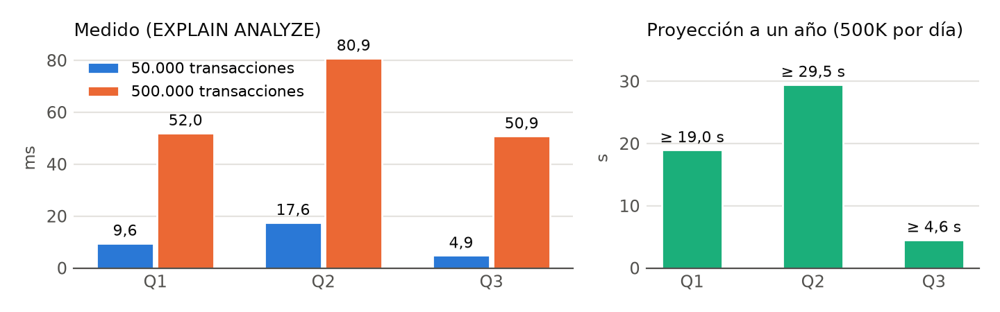
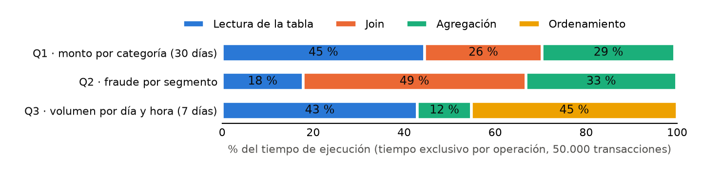
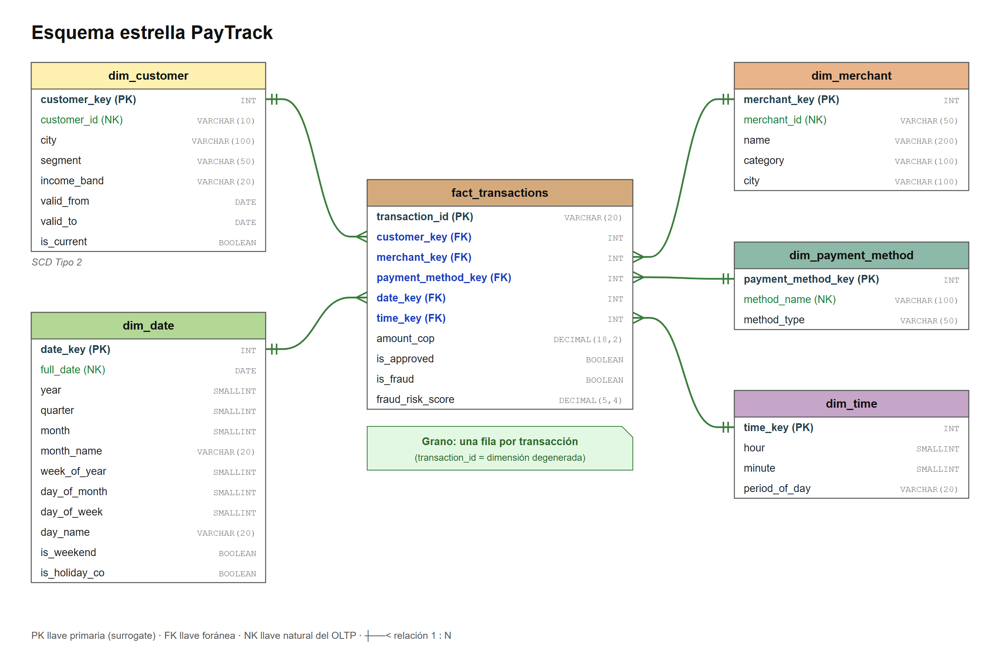
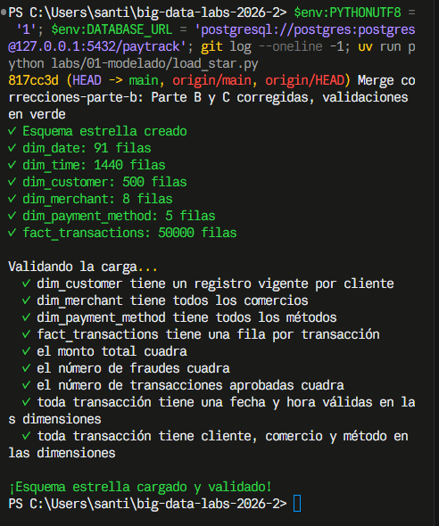

# Lab 1 · Modelado OLTP → OLAP

**SI7006 Almacenamiento y Procesamiento de Grandes Datos · Maestría en Ingeniería de Datos · EAFIT 2026-2**  
**Caso:** PayTrack Colombia · **Equipo:** Santiago Vélez Casallas · Luis Alberto Ortiz Quiroga  
**Repositorio:** https://github.com/santiagovelcasallas/big-data-labs-2026-2

> Borrador en Markdown; se entrega en PDF. Enunciado: *"Informe en PDF (máx. 3 páginas): diagnóstico del OLTP
> (Parte A), decisiones de diseño (Parte B) y comparación de rendimiento con planes de ejecución (Parte D)"*.
> Las evidencias citadas están en `labs/01-modelado/evidencias/`. Anexos (fuera de las 3 páginas): **A** diagrama del
> esquema estrella, **B** diccionario de datos, **C** carga ELT (Parte C) con la validación de `load_star.py`.

---

## 1. Diagnóstico del OLTP (Parte A)

Se ejecutaron las tres consultas de `sql/oltp_problems.sql` con `EXPLAIN ANALYZE` sobre el esquema `oltp` (3FN), con
50.000 y con 500.000 transacciones (procedimiento y evidencias en `PARTE_A.md` y `evidencias/parte_a_*`).
Con 10 veces más datos, Q1 pasa de 9,6 a 52,0 ms, Q2 de 17,6 a 80,9 ms y Q3 de 4,9 a 50,9 ms (**Figura 1**). Con 500K
transacciones diarias durante un año (unos 182,5 M de filas, cerca de 16 GB) serían, como mínimo, 19,0 s, 29,5 s y 4,6 s:
proyección lineal con los datos en memoria.

**Figura 1.** Tiempo de ejecución medido (izquierda) y proyectado a un año (derecha).

**Figura 2.** En qué se va el tiempo de cada consulta: tiempo exclusivo por tipo de operación del plan (50.000).

| Consulta | ¿Qué operaciones dominan el plan (scans, joins, sorts)? | ¿Por qué el diseño en 3FN obliga a hacer ese trabajo? | ¿Qué pasaría con estos tiempos con 500K transacciones diarias durante un año? |
|---|---|---|---|
| Q1 · monto por categoría (30 días) | **Lectura, 45 %** (Fig. 2): el índice de `created_at` halla 16.646 filas, pero se visitan las 569 páginas. Con 500K pasa a Parallel Seq Scan. | `category` vive en `merchants`: un join por transacción. La fecha es un `TIMESTAMP` sin atributos de periodo. | La ventana tendría ~15 M de filas y se lee la tabla completa: **≥ 19,0 s** (Fig. 1). |
| Q2 · fraude por segmento | **Join, 49 %**: el Hash Join con `customers` une las 50.000 filas para producir 3 grupos. | `segment` vive en `customers`, y el 3FN guarda solo el actual: los fraudes antiguos se atribuyen al segmento nuevo. | Recorre toda la historia y crece cada día: **≥ 29,5 s**, la que peor escala. |
| Q3 · volumen por día y hora (7 días) | **Ordenamiento, 45 %**, y lectura, 43 %: Sort por `EXTRACT(DOW/HOUR)`. Estima 3.776 grupos para 168 reales. | Día y hora se recalculan desde `created_at` en cada fila, sin índice ni estadísticas. | ~3,5 M de filas: **≥ 4,6 s**. El Sort (~285 MB) supera `work_mem` (4 MB) y pasa a disco. |

**Conclusión.** El 3FN optimiza registrar pagos sin redundancia. A cambio, cada consulta analítica reconstruye el
contexto con joins, atributos de calendario calculados y lecturas amplias, y además pierde la historia de los atributos que cambian.

## 2. Decisiones de diseño (Parte B)

**Proceso de negocio y grano de la tabla de hechos.**  
El proceso es el **procesamiento de pagos**: cada intento de pago de un cliente en un comercio con un método de pago,
aprobado o rechazado. El grano es **una fila por transacción** de `oltp.transactions`, el nivel más atómico: las tres preguntas se responden agregando. `transaction_id` es la
PK de `fact_transactions` y una *dimensión degenerada*: identifica la transacción, pero no tiene atributos propios.
El diseño completo está en el **Anexo A** (diagrama: tablas, llaves, cardinalidades 1:N y grano) y el **Anexo B**
(diccionario de datos: cada tabla, columna, tipo, llave y relación).

**Dimensiones y los atributos de cada una. ¿Qué datos del OLTP *no* deben llegar al data warehouse?**

| Dimensión | Surrogate key | Natural key | Atributos |
|---|---|---|---|
| `dim_date` (dada) | `date_key` | `full_date` | año, trimestre, mes, semana, día, festivo |
| `dim_time` (dada) | `time_key` | — | `hour`, `minute`, `period_of_day` |
| `dim_customer` (SCD2) | `customer_key` | `customer_id` | `city`, `segment`, `income_band`, `valid_from`, `valid_to`, `is_current` |
| `dim_merchant` | `merchant_key` | `merchant_id` | `name`, `category`, `city` |
| `dim_payment_method` | `payment_method_key` | `method_name` | `method_type` (card, digital_wallet, bank_transfer) |

No llegan al DW:

- `name` y `email` del cliente: identifican a la persona y no responden ninguna pregunta analítica (principio de minimización, Ley 1581 de 2012).
- `monthly_income_cop` exacto: es un dato financiero sensible. Se reemplaza por `income_band` (< 3 M, 3–6 M,
  6–10 M, ≥ 10 M COP), que conserva su valor analítico.
- `method_id` (llave técnica) y el detalle de `fraud_events` (`event_id`, `pattern`, `detected_at`): solo pasa
  `risk_score` como medida. `status` se convierte en la medida `is_approved`.

**Medidas de la tabla de hechos y si son aditivas, semiaditivas o no aditivas.**

- `amount_cop`: **aditiva**. Se suma por cualquier dimensión.
- `is_fraud` e `is_approved`: banderas que, como 0/1, son **aditivas** (`SUM(is_fraud::INT)` da el número de
  fraudes). Las tasas que se derivan de ellas, como `fraud_rate_pct` en Q2, son **no aditivas**: se calculan como
  cociente de sumas, nunca sumando tasas.
- `fraud_risk_score`: **no aditiva**. Se agrega con `AVG` o `MAX`; sumar puntajes no tiene significado. Es `NULL` en las transacciones sin evento de fraude.
- **Semiaditivas: ninguna.** Un saldo no se suma en el tiempo; eso ocurre en hechos *snapshot*, no en uno transaccional.

**Por qué surrogate keys en lugar de las llaves del OLTP.**  
(1) **SCD2:** un `customer_id` tiene varias versiones, así que no puede ser PK; cada versión necesita su propia llave.
(2) **Independencia:** el DW no depende de que el OLTP conserve o reutilice sus llaves, y admite otras fuentes.
(3) **Tamaño:** un `INT` de 4 bytes frente a un `VARCHAR(10)` achica hechos e índices y abarata los joins (182,5 M de filas al año).

**Por qué SCD Tipo 2 para la dimensión cliente: ¿qué atributo puede cambiar y qué análisis se daña si se sobrescribe?**  
Pueden cambiar `segment` y `city`: el generador del curso simula clientes que *"se mudan de ciudad o cambian de segmento
entre lotes"*. Si se sobrescribe (tipo 1), las transacciones antiguas quedan con el valor actual: un cliente con fraudes
siendo `mass` que pasa a `premium` sube la tasa de `premium` y baja la de `mass`, y *"¿Qué segmento de clientes tiene mayor
tasa de fraude?"* queda con una respuesta falsa. Con SCD2 cada cambio crea una versión y cada transacción apunta con
`customer_key` a la vigente en su fecha.

**Tipos de dato e índices** (`star_schema.sql`). Surrogate keys `INT … IDENTITY`. El índice único parcial
`ux_dim_customer_current … WHERE is_current` garantiza una sola versión vigente por cliente. Estos cuatro los fija el dato de origen:

| Columna | Tipo | Por qué |
|---|---|---|
| `transaction_id` (hechos) | `VARCHAR(20)` PK | Dimensión degenerada: conserva el código del OLTP (`TXN0000000001`); un `IDENTITY` rompería la trazabilidad. |
| `fraud_risk_score` (hechos) | `DECIMAL(5,4)` | Mismo tipo que `fraud_events.risk_score`; con 2 decimales, 0,7884 quedaría en 0,79. |
| `income_band` (cliente) | `VARCHAR(20)` | Es una etiqueta de rango (`'3-6M'`), no un número; se calcula en la carga. |
| `ix_fact_*` | B-tree en las 5 FK | Para joins y filtros; su efecto se mide en la Parte D. |

La carga que implementa este diseño (Parte C) y sus 9 validaciones en verde están en el **Anexo C**.

## 3. Comparación de rendimiento con planes de ejecución (Parte D)

Las consultas de `sql/olap_queries.sql` usan solo `dw.*` y dan los mismos resultados que las del OLTP en los dos volúmenes
(`check_queries.py` 3/3; celda por celda y sin redondeo, ninguna diferencia). Tiempos: mediana de 5 `EXPLAIN ANALYZE`, caché caliente.
Planes completos en `evidencias/parte_d_50000/` y `parte_d_500000/`; procedimiento en `PARTE_D.md`.

**Ejecuta ambas versiones con `EXPLAIN ANALYZE` y compara: tiempo total, tipos de scan y joins, filas procesadas.**

| Consulta | Modelo | 50K (ms) | 500K (ms) | Scan de la tabla grande, 50K → 500K | Joins | Filas leídas 500K | OLAP/OLTP 50K → 500K |
|---|---|---|---|---|---|---|---|
| Q1 | OLTP | 8,96 | 50,67 | Bitmap Heap (`idx_txn_created_at`) → Parallel Seq | 1 Hash | 500.025 | **1,51× → 1,06×** |
| | OLAP | 13,56 | 53,83 | Seq → Parallel Seq | 2 Hash | 500.295 | |
| Q2 | OLTP | 18,19 | 73,23 | Seq → Parallel Seq | 1 Hash | 501.501 | **0,99× → 1,01×** |
| | OLAP | 17,98 | 74,18 | Seq → Parallel Seq | 1 Hash | 501.501 | |
| Q3 | OLTP | 5,82 | 31,17 | Bitmap Heap (`idx_txn_created_at`) | — | 21.905 | **1,66× → 1,20×** |
| | OLAP | 9,66 | 37,46 | Seq → Parallel Seq | 2 Hash | 504.591 | |

En este montaje el modelo estrella **no es más rápido**: empata en Q2 y es más lento en Q1 y Q3. Hay tres razones:

1. **PostgreSQL guarda las filas completas (almacenamiento por filas).** La ventaja del esquema estrella aparece en motores
   columnares (Redshift, BigQuery, Snowflake), que leen solo las columnas que la consulta usa, o con la tabla de hechos
   particionada por fecha. Aquí `fact_transactions` y `transactions` se leen fila a fila con el mismo Seq Scan: las filas
   leídas son prácticamente las mismas en Q1 y Q2.
2. **El OLTP filtra la fecha con su propio índice; la estrella, a través de una dimensión.** `transactions.created_at` tiene
   índice, y en Q3 el OLTP lee solo las 21.905 filas de la semana. En la estrella el filtro está en `dim_date.full_date`:
   el optimizador lee las 500.000 filas de hechos y descarta en el Hash Join, porque no convierte ese filtro en un
   rango sobre `date_key`. Por eso Q3 es la que más pierde.
3. **El sobrecosto de la estrella es casi fijo y pesa menos a medida que crecen los datos.** Los joins extra son con dimensiones
   pequeñas (91 fechas, 1.440 minutos, 8 comercios): construir su tabla hash cuesta lo mismo con 50.000 que con 500.000
   hechos. La tabla lo muestra: con 10 veces más datos la desventaja baja de 1,51× a 1,06× en Q1 y de 1,66× a 1,20×
   en Q3. En Q1 desaparece también la ventaja del índice del OLTP, que con 500.000 filas pasa a Parallel Seq Scan igual que la estrella.

Lo que la estrella sí resuelve es lo que el 3FN no puede: Q2 respeta la historia del cliente (SCD2) y Q3 no recalcula
`EXTRACT()` en cada fila.

**Experimenta con los índices de la tabla de hechos (TODO 5 de `star_schema.sql`): mide el plan con y sin cada índice. ¿Todos ayudan? ¿Por qué el optimizador a veces prefiere un *sequential scan*?**  
Se midieron 7 configuraciones en cada volumen: con los 5 índices, sin cada uno por separado y sin ninguno (`BEGIN; DROP INDEX …; ROLLBACK`).
**Ninguno ayuda:** en las 7 el plan es el mismo `Seq Scan`, y ninguna de las tres consultas usa ningún índice. Q1 necesita el 30 % de la tabla y
Q2 el 100 %, y los joins se resuelven con Hash Join, que lee la tabla una vez en vez de buscar fila por fila. Para ver por qué,
se prohibió el sequential scan (`SET enable_seqscan = off`):

| Consulta (fracción de la tabla) | Plan forzado | 50.000: elegido → forzado | 500.000: elegido → forzado |
|---|---|---|---|
| Q1 (30 %) | Bitmap Heap Scan `ix_fact_date` | 15,3 → 15,3 ms | 55,7 → **179,0 ms** |
| Q2 (100 %) | Index Scan `ix_fact_customer` | 16,3 → **31,5 ms** | 69,6 → **164,7 ms** |
| Q3 (4–5 %) | Bitmap Heap Scan `ix_fact_date` | 8,6 → **3,6 ms** | 36,3 → **25,1 ms** |

El optimizador elige por costo estimado. Leer páginas contiguas cuesta `seq_page_cost = 1`, y un índice obliga a un
acceso aleatorio por fila (`random_page_cost = 4`). Cuando se necesita una fracción grande de la tabla (Q1, Q2), el
sequential scan es más barato, y forzar el índice multiplica el tiempo hasta por 3,2. En Q3, que es selectiva, el
índice sí sería más rápido, pero el optimizador no lo ve. Hay dos causas: el filtro llega desde `dim_date` y no desde
la tabla de hechos, y `random_page_cost = 4` supone un disco giratorio, no un SSD con los datos en caché.

---

## Anexo A. Diagrama del esquema estrella

`fact_transactions` está al centro, con una relación 1:N con cada una de las 5 dimensiones; `dim_customer` es SCD Tipo 2.
El archivo draw.io se entrega aparte.

**Figura A.1.** Esquema estrella PayTrack. Grano: una fila por transacción.

## Anexo B. Diccionario de datos

Elaborado por el equipo para la Parte B. Los tipos son los de `sql/star_schema.sql` y los valores de dominio, los de `load_star.py`.

### B.1 Tablas de hechos y dimensiones

| Tabla | Tipo | Grano | Descripción | Nº cols | Clave primaria |
|---|---|---|---|---|---|
| `fact_transactions` | Hecho | Una fila por transacción | Tabla de hechos central. Registra cada transacción de pago con su monto, resultado de aprobación y riesgo de fraude. | 10 | `transaction_id` |
| `dim_date` | Dimensión | Una fila por día calendario | Calendario con atributos de año, trimestre, mes, semana y día, incluyendo festivos de Colombia. | 12 | `date_key` |
| `dim_time` | Dimensión | Una fila por hora y minuto | Hora y minuto del día con su franja (mañana, tarde, noche, madrugada). Separada de la fecha para no multiplicar filas de calendario. | 4 | `time_key` |
| `dim_customer` | Dimensión | Una fila por versión del cliente | Clientes con su segmento y rango de ingresos. Es SCD 2: guarda historial de cambios con fechas de vigencia. | 8 | `customer_key` |
| `dim_merchant` | Dimensión | Una fila por comercio | Comercios donde se realizan las transacciones, con su categoría y ciudad. | 5 | `merchant_key` |
| `dim_payment_method` | Dimensión | Una fila por método de pago | Métodos de pago disponibles y su tipo. | 3 | `payment_method_key` |

### B.2 Columnas

| Tabla | Columna | Rol | Tipo dato | Clave | Referencia | Descripción |
|---|---|---|---|---|---|---|
| **`fact_transactions`** | `transaction_id` | Identificador (grano) | VARCHAR(20) | PK |  | Identificador único de la transacción. Define el grano de la tabla. Código de la transacción en el sistema origen |
|  | `customer_key` | Clave foránea | INT | FK | `dim_customer.customer_key` | Versión del cliente vigente al momento de la transacción. |
|  | `merchant_key` | Clave foránea | INT | FK | `dim_merchant.merchant_key` | Comercio donde se realizó la transacción. |
|  | `payment_method_key` | Clave foránea | INT | FK | `dim_payment_method.payment_method_key` | Método de pago utilizado. |
|  | `date_key` | Clave foránea | INT | FK | `dim_date.date_key` | Fecha en que ocurrió la transacción. |
|  | `time_key` | Clave foránea | INT | FK | `dim_time.time_key` | Hora y minuto en que ocurrió la transacción. |
|  | `amount_cop` | Medida | DECIMAL(18,2) |  |  | Monto de la transacción en pesos colombianos (COP). Medida aditiva. |
|  | `is_approved` | Indicador | BOOLEAN |  |  | Indica si la transacción fue aprobada. ( APROBADA – TRUE / DECLINADA - FALSE) |
|  | `is_fraud` | Indicador | BOOLEAN |  |  | Indica si la transacción fue marcada como fraude. (FRAUDULENTA – TRUE / NO FRAUDULENTA - FALSE) |
|  | `fraud_risk_score` | Medida | DECIMAL(5,4) |  |  | Puntaje de riesgo de fraude asignado a la transacción. Mayor valor implica mayor riesgo. |
| **`dim_date`** | `date_key` | Clave sustituta | INT | PK |  | Identificador de la fecha en la dimensión. |
|  | `full_date` | Atributo | DATE |  |  | Fecha calendario completa. Ej.: 2026-03-15 |
|  | `year` | Atributo | SMALLINT |  |  | Año. Ej.: 2026 |
|  | `quarter` | Atributo | SMALLINT |  |  | Trimestre del año. 1 a 4 |
|  | `month` | Atributo | SMALLINT |  |  | Número del mes. 1 a 12 |
|  | `month_name` | Atributo | VARCHAR(20) |  |  | Nombre del mes. Ej.: marzo |
|  | `week_of_year` | Atributo | SMALLINT |  |  | Número de semana dentro del año. 1 a 52 |
|  | `day_of_month` | Atributo | SMALLINT |  |  | Día del mes. 1 a 31 |
|  | `day_of_week` | Atributo | SMALLINT |  |  | Número del día de la semana: 0 = domingo … 6 = sábado (`EXTRACT(DOW)`). |
|  | `day_name` | Atributo | VARCHAR(20) |  |  | Nombre del día de la semana. Ej.: domingo |
|  | `is_weekend` | Indicador | BOOLEAN |  |  | Indica si el día es sábado o domingo. TRUE / FALSE |
|  | `is_holiday_co` | Indicador | BOOLEAN |  |  | Indica si el día es festivo en Colombia. TRUE / FALSE. Default FALSE |
| **`dim_time`** | `time_key` | Clave sustituta | INT | PK |  | Identificador del momento del día en la dimensión. |
|  | `hour` | Atributo | SMALLINT |  |  | Hora del día. 0 a 23 |
|  | `minute` | Atributo | SMALLINT |  |  | Minuto de la hora. 0 a 59 |
|  | `period_of_day` | Atributo | VARCHAR(20) |  |  | Franja del día: `morning` (6–11 h), `afternoon` (12–17 h), `evening` (18–22 h), `night`. |
| **`dim_customer`** | `customer_key` | Clave sustituta | INT | PK |  | Identificador de la versión del cliente en la dimensión. Cambia cada vez que se registra un cambio (SCD Tipo 2). |
|  | `customer_id` | Clave natural | VARCHAR(10) | NK |  | Identificador del cliente en el sistema origen. Se repite en todas las versiones del mismo cliente. |
|  | `city` | Atributo | VARCHAR(100) |  |  | Ciudad del cliente. Ej.: Medellín |
|  | `segment` | Atributo | VARCHAR(50) |  |  | Segmento comercial al que pertenece el cliente.(mass, premium, high_value) |
|  | `income_band` | Atributo | VARCHAR(20) |  |  | Rango de ingreso mensual: `<3M`, `3-6M`, `6-10M` o `>=10M`. No se guarda el valor exacto. |
|  | `valid_from` | Control SCD2 | DATE |  |  | Fecha de inicio de vigencia de esta versión del cliente. |
|  | `valid_to` | Control SCD2 | DATE |  |  | Fecha de fin de vigencia de esta versión. Para la versión vigente queda abierta. |
|  | `is_current` | Control SCD2 | BOOLEAN |  |  | Indica si esta es la versión vigente del cliente. TRUE / FALSE |
| **`dim_merchant`** | `merchant_key` | Clave sustituta | INT | PK |  | Identificador del comercio en la dimensión. |
|  | `merchant_id` | Clave natural | VARCHAR(50) | NK |  | Identificador del comercio en el sistema origen. |
|  | `name` | Atributo | VARCHAR(200) |  |  | Nombre del comercio. |
|  | `category` | Atributo | VARCHAR(100) |  |  | Categoría o rubro del comercio. |
|  | `city` | Atributo | VARCHAR(100) |  |  | Ciudad donde opera el comercio. Ej.: Bogotá |
| **`dim_payment_method`** | `payment_method_key` | Clave sustituta | INT | PK |  | Identificador del método de pago en la dimensión. |
|  | `method_name` | Clave natural | VARCHAR(100) | NK |  | Nombre del método de pago (credit_card, debit_card, nequi) |
|  | `method_type` | Atributo | VARCHAR(50) |  |  | Tipo de método de pago: `card`, `digital_wallet` o `bank_transfer`. |

### B.3 Integridad referencial y cardinalidad

| Tabla padre | Columna padre | Tabla hija | Columna hija | Cardinalidad | Descripción |
|---|---|---|---|---|---|
| `dim_date` | `date_key` | `fact_transactions` | `date_key` | 1 : N | Una fecha puede tener muchas transacciones. |
| `dim_time` | `time_key` | `fact_transactions` | `time_key` | 1 : N | Un momento del día puede tener muchas transacciones. |
| `dim_customer` | `customer_key` | `fact_transactions` | `customer_key` | 1 : N | Una versión de cliente puede tener muchas transacciones. |
| `dim_merchant` | `merchant_key` | `fact_transactions` | `merchant_key` | 1 : N | Un comercio puede tener muchas transacciones. |
| `dim_payment_method` | `payment_method_key` | `fact_transactions` | `payment_method_key` | 1 : N | Un método de pago puede tener muchas transacciones. |

## Anexo C. Carga ELT del esquema estrella (Parte C, `load_star.py`)

Cada paso es un `INSERT … SELECT` de `oltp.*` a `dw.*`:

- **`dim_customer`:** una versión por cliente. `valid_from` es la fecha de alta, `valid_to` = `9999-12-31` (abierta),
  `is_current` = `TRUE`, e `income_band` sale de un `CASE` sobre `monthly_income_cop` (< 3 M, 3–6 M, 6–10 M, ≥ 10 M).
  No se cargan `name`, `email` ni el ingreso exacto.
- **`dim_payment_method`:** `method_type` es un atributo nuevo que no existe en el OLTP: `card`, `digital_wallet`, `bank_transfer`.
- **`fact_transactions`:** cada natural key se traduce a su surrogate key con un `JOIN`. El cliente se busca con el
  intervalo semiabierto `created_at::DATE >= valid_from AND < valid_to`, así que cada fecha cae en una sola versión. `date_key`
  (`YYYYMMDD`) y `time_key` (`HHMM`) salen de `created_at`, e `is_approved` = `status = 'approved'`. `risk_score` llega con
  `LEFT JOIN` a `fraud_events`: solo 200 de 50.000 transacciones tienen evento, y las demás quedan con `NULL` sin perderse.

Resultado en `main` (`817cc3d`): las 9 validaciones de `verify()` en verde, y `check_queries.py` 3/3.

**Figura C.1.** Salida de `load_star.py` en `main`.

