# Lab 2 · Lakehouse end-to-end en AWS: batch y streaming

**SI7006 Almacenamiento y Procesamiento de Grandes Datos · Maestría en Ingeniería de Datos · EAFIT 2026-2**  
**Caso:** PayTrack Colombia · **Equipo:** Luis Alberto Ortiz Quiroga · Santiago Vélez Casallas  
**Repositorio:** https://github.com/santiagovelcasallas/big-data-labs-2026-2 (rama `lab2`)

Las preguntas son las del enunciado. Evidencias: `labs/02-lakehouse/entrega/evidencias/`. Salvo que se indique lo contrario, las cifras locales vienen de `lakehouse-local`, que acumula varias corridas; las de AWS, de la corrida completa del 2026-11-04.

## Parte A · Batch

**1. Bronze.** ¿Por qué Bronze lee todo como texto? ¿Qué problema evita `replaceWhere` frente a `append`? Muéstralo con lo que pasó en tu prueba de idempotencia.

Bronze conserva el dato tal como llegó, sin decidir todavía qué es válido. Lo lee con `primitivesAsString` porque los datos vienen sucios: en el lote 1, `amount_cop` llega como número decimal (29.697), entero (303) y **texto (600)**. Tipar aquí perdería esos valores o haría fallar la lectura; Silver hace el tipado y manda lo inválido a cuarentena.

`replaceWhere` reemplaza solo la partición del lote, así que re-ejecutar no duplica ni toca otros lotes; `append` volvería a agregar las filas. En la prueba de idempotencia, las dos ejecuciones de cada lote dejaron la misma cantidad: **30.600 y 2.316 filas**. Con `append`, el lote 1 habría quedado en 61.200.

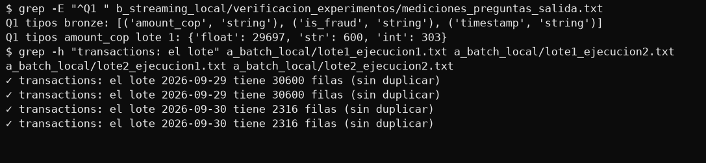

**2. Silver.** ¿Cuántas filas quedaron en cuarentena por cada motivo en cada lote? ¿Por qué se deduplica **antes** de aplicar las reglas de calidad?

| Lote | Filas en Bronze | Duplicadas | Distintas | `invalid_amount` | `missing_customer` | Válidas |
|---|---|---|---|---|---|---|
| 2026-09-29 | 30.600 | 600 | 30.000 | 1.178 | 584 | 28.238 |
| 2026-09-30 | 2.316 | 40 | 2.276 | 78 | 40 | 2.158 |

No hubo filas con `invalid_status`. Se deduplica antes porque una fila repetida con un problema entraría varias veces a cuarentena e inflaría sus cifras. Así se cumple que válidas + cuarentena = distintas: 28.238 + 1.762 = 30.000 y 2.158 + 118 = 2.276.

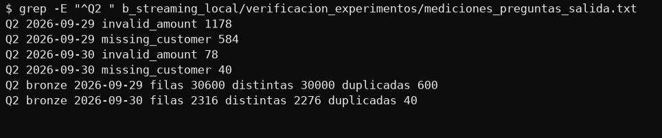

**3. MERGE.** ¿Por qué la actualización solo debe ocurrir cuando el `status` cambió? ¿Qué reportaría la auditoría si quitaras esa condición y re-ejecutaras un lote?

Porque sin la condición el `MERGE` reescribiría filas que no cambiaron y movería su `silver_updated_at`, y la auditoría dejaría de medir cambios reales. Se probó sobre una copia de la tabla, re-integrando 1.882 filas del lote 2: **con la condición reporta 0 actualizadas; sin ella, 1.882 actualizadas con 0 cambios reales de status**. La auditoría reportaría esas 1.882 y su validación fallaría, porque exige que `status_changes` coincida con las filas actualizadas.

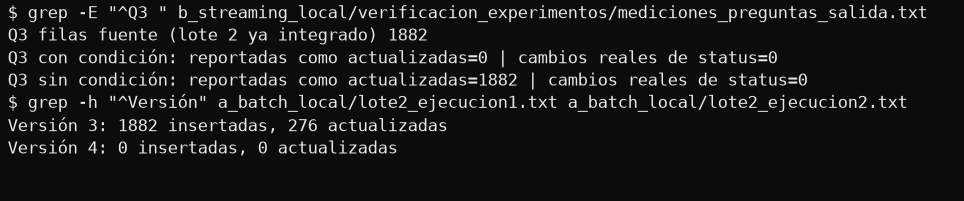

**4. Time travel.** ¿Cuántos contracargos encontró la auditoría y qué monto revierten? ¿Qué pasaría con esta auditoría después de un `VACUUM`?

Encontró **276 contracargos** (de `approved` a `chargeback`) que revierten **COP 23.933.218,70**, con la misma cifra en local y en AWS. Después de un `VACUUM`, las versiones cuyos archivos se hayan borrado ya no se pueden leer con `versionAsOf`, así que la auditoría fallaría al comparar contra ellas. Por defecto, `VACUUM` conserva 7 días. El historial del `_delta_log` seguiría visible, pero sin los datos. Esto último no se probó: sale de la documentación de Delta.

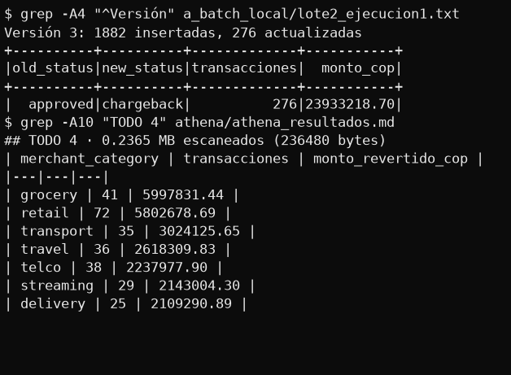

**5. PII.** `silver.customers` se actualiza sobrescribiendo los cambios (tipo 1). ¿Qué análisis de negocio se pierde? ¿Cómo lo resolverías con lo que hiciste en el Lab 1?

Se pierde el análisis según el valor que el cliente tenía **cuando ocurrió** la transacción: si se muda o cambia de segmento, toda su historia pasa al valor nuevo. Por ejemplo, sus fraudes como `mass` quedarían contados en `premium`, y lo mismo con las ventas por ciudad. Se resuelve como en el Lab 1, con SCD Tipo 2: una fila por versión, con `valid_from`, `valid_to` e `is_current`, y cada transacción apuntando a la versión vigente en su fecha.

**6. Consumo.** Compara los MB escaneados del TODO 1 y del TODO 2 de Athena. ¿Por qué existe Gold si Silver ya responde la pregunta? ¿Qué pierdes?

| Consulta | Fuente | Bytes escaneados | Copa Airlines: monto aprobado | Tasa |
|---|---|---|---|---|
| TODO 1 | Gold | **3.301** | 164.428.882,95 | 99,21 % |
| TODO 2 | Silver | **96.151** (29 veces más) | 164.174.231,87 | 98,91 % |

Gold existe porque responde la misma pregunta leyendo mucho menos, y fija una sola definición de la métrica. La diferencia pesa poco con estos datos y mucho con 182 M de filas al año. Lo que se pierde es **frescura y detalle**: las cifras difieren porque Gold se calculó antes del stream, cuyos contracargos ya están en Silver, y Gold solo tiene las dimensiones que se agregaron.

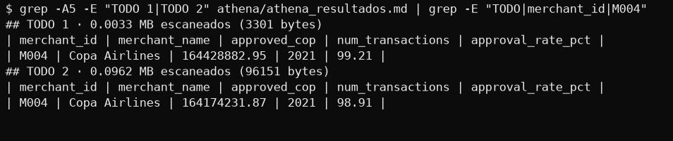

## Parte B · Streaming

**7. Garantías de entrega.** ¿Qué garantía da tu productor: *at-most-once*, *at-least-once* o *exactly-once*? ¿Y Kinesis con tus reintentos? Explica qué combinación de checkpoint, Delta y `MERGE` hace que las tablas queden como si cada evento se hubiera procesado exactamente una vez. Usa tu prueba de idempotencia como evidencia.

**El productor da at-least-once.** `acks=all` evita perder un evento confirmado y `enable.idempotence` evita que los reintentos internos dupliquen o reordenen, pero la fuente reenvía eventos con el mismo `event_id`, y Kafka los ve como mensajes nuevos. **Kinesis con nuestros reintentos también es at-least-once**, con un límite: si un registro falla los 4 intentos se pierde y se reporta. En todas las corridas el conteo fue de 0 perdidos.

Las tablas quedan como *exactly-once* por la combinación de tres piezas: el **checkpoint** recuerda hasta dónde se leyó, **Delta** confirma cada escritura de forma atómica y el **`MERGE`** por `transaction_id` absorbe los repetidos. Evidencia: la segunda ejecución leyó **0 filas en las 4 consultas** y las tablas no cambiaron (41.839 transacciones, 96 ventanas y 123 alertas).

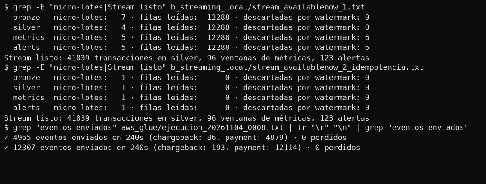

**8. Watermark.** Responde el experimento 1. ¿Por qué la consulta `silver` no usa watermark? ¿Qué pasaría con los pagos tardíos si lo usara?

El experimento 1 está respondido en la sección B.3: los descartes pasan de 6 con `--fast` a 51 en vivo porque el watermark avanza entre micro-lotes y en vivo sigue de cerca al tiempo de evento.

`silver` no usa watermark porque es la tabla de verdad y no puede perder pagos: se integra con `MERGE`, sin estado que limpiar, y por eso en todas las corridas reporta **0 descartadas**. Si lo usara, los pagos con más de 2 minutos de retraso nunca llegarían a Silver. En la corrida local a 20/s fueron 61 eventos de 2.487 con ese retraso, y Spark descartó 51 en `metrics`: serían pagos reales faltantes en Silver, en Gold y en la auditoría.

**9. Latencia.** ¿Cuánto tarda en aparecer una alerta en `gold.fraud_alerts` después del último pago de la ráfaga? ¿Qué parte de ese tiempo se debe al modo *append* y al watermark? ¿Cómo la bajarías y qué perderías?

Se midió en una corrida local en vivo de 5 minutos, desde el último pago de cada ráfaga hasta la escritura de la alerta: **mediana de 152 s (entre 138 y 166 s)**, en 16 alertas con fraude. De esa espera, **120 s son el watermark**: el modo *append* solo emite una ventana cuando el watermark pasa su final. Desde el cierre de la ventana hasta la alerta hay una mediana de 150 s; el resto son los micro-lotes de 10 s y el avance del watermark, que se aplica en el lote siguiente.

Para bajarla se puede reducir el watermark, con el costo de descartar más pagos tardíos y por tanto perder alertas, o usar modo *update*, que emite antes pero puede repetir una alerta al llegar más pagos. No se midió en AWS.

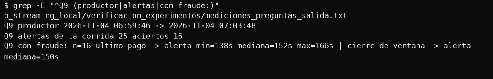

**10. Precisión.** Reporta la precisión de las alertas (TODO 5) a 20 y a 50 eventos/s. ¿Por qué cambia? ¿Qué ajustarías para mejorarla?

En AWS, la precisión fue **93,75 % a 20 eventos/s** (30 de 32) y **~25,11 % a 50 eventos/s** (110 de 438). Cambia porque la regla es absoluta: con más tráfico, un cliente normal llega a 6 pagos en 30 s por azar, como se muestra en el experimento 2.

Para ajustar, se probaron alternativas sobre los pagos locales a 50/s, sin pasar por el job de streaming:

| Regla a 50 eventos/s | Alertas | Precisión | Clientes con fraude detectados |
|---|---|---|---|
| 6 pagos en 30 s (actual) | 372 | 25,8 % | 32 de 32 |
| 7 pagos en 30 s | 172 | 48,3 % | 30 de 32 |
| 9 pagos en 30 s | 55 | 87,3 % | 21 de 32 |
| **6 pagos en 15 s** | 108 | **69,4 %** | **31 de 32** |

Subir el umbral mejora la precisión a costa de perder fraude, porque las ráfagas tienen solo 6 a 8 pagos. **Acortar la ventana** es el mejor ajuste probado: las ráfagas caben en unos 14 s y la actividad normal acumula menos pagos. También se podría comparar a cada cliente con su propia actividad habitual, pero eso no se probó.

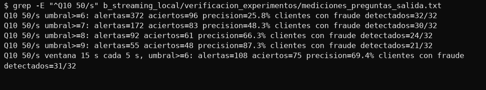

**11. Estado final.** En el TODO 4, ¿qué escenario concreto del productor revertiría un contracargo si quitaras la condición sobre `'chargeback'`? ¿Por qué `latest_per_transaction` no basta para evitarlo?

Un **reenvío del pago original**: el productor reenvía eventos con el mismo `event_id` y `status = 'approved'`. Si ese reenvío llega en un micro-lote posterior al del contracargo, el `MERGE` vería un status distinto y volvería a dejarlo en `approved`. `latest_per_transaction` no basta porque solo compara eventos **dentro de un mismo micro-lote**: no ve el contracargo que ya está en Silver. Por eso la condición debe estar en el `MERGE`, que sí compara contra la tabla.

En nuestros datos locales el caso no ocurrió: de 544 contracargos, ninguno recibió después otro evento de esa transacción. Es poco frecuente porque se reenvían solo eventos recientes y casi todos los contracargos son de pagos antiguos, pero la condición protege cuando ocurra.

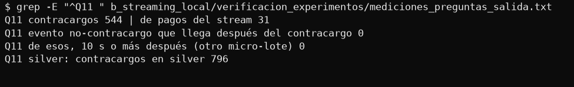

**12. Partition key.** Con el experimento 3: ¿cómo se repartió la carga con cada llave? ¿Cambiaría el número de alertas que detecta Spark con `transaction_id` como llave? Si Spark agrupa por cliente de todas formas, ¿para qué sirve la partition key? (piensa en el contracargo y su pago).

El reparto está en el experimento 3 de la sección B.3: con llave constante todo cae en una partición, y `transaction_id` reparte mejor (+7 %) que `customer_id` (+20 %).

El número de alertas no debería cambiar con `transaction_id`, porque Spark agrupa por `customer_id` y `event_time` después de leer, sin importar la partición. Esto se deduce del diseño: no se midió, porque los topics del experimento no se procesaron con el job.

La partition key sirve para **el orden y el reparto de carga**, no para agrupar. Kafka y Kinesis solo garantizan orden dentro de una partición: la llave debe mantener juntos los eventos que necesitan orden, como un pago y su contracargo. `customer_id` y `transaction_id` lo cumplen, porque el contracargo conserva ambos valores, pero `customer_id` además mantiene en orden toda la actividad del cliente, incluidas sus ráfagas.

**13. Batch y streaming en la misma tabla.** Revisa `DESCRIBE HISTORY` de `silver.transactions` después del streaming: ¿cuántas versiones creó?, ¿cuántas filas reescribió cada `MERGE` (`numTargetRowsCopied`)? ¿Qué problema anticipas a 500K pagos/día y cómo lo resolverías? ¿Qué pasaría si el job silver batch y el stream escribieran al mismo tiempo? Con el TODO 6 de Athena: ¿cuál es la fuente de verdad, la capa rápida o la batch?

El historial de AWS no se guardó antes de borrar la tabla, así que estos datos son del historial local, que acumula todas las corridas. Tiene **49 versiones: 1 `WRITE` y 48 `MERGE`, de las que 44 son del stream**. Esos 44 `MERGE` integraron 27.730 filas y **reescribieron 1.289.391** (`numTargetRowsCopied`): en promedio 29.304 por `MERGE`, unas 46 filas copiadas por cada fila de entrada.

**A 500K pagos/día** el problema se agrava: con un micro-lote cada 10 s hay hasta 8.640 `MERGE` diarios, cada uno copiando una tabla que no para de crecer. Se resuelve restringiendo el `MERGE` a las particiones afectadas, alargando el intervalo de los micro-lotes y compactando con `OPTIMIZE`.

**Si el job batch y el stream escriben a la vez**, Delta aplica concurrencia optimista: si ambos tocan los mismos archivos, uno falla con un conflicto y debe reintentar. Esto no se probó; se evitaría no ejecutándolos en paralelo.

**Fuente de verdad:** Silver, la capa batch. En el TODO 6 de AWS, tras el stream a 20/s, las métricas suman 2.060 pagos y Silver 4.738. La capa rápida se queda corta porque no incluye los pagos descartados por el watermark ni las ventanas aún sin cerrar; sirve para reaccionar rápido, no para conciliar.

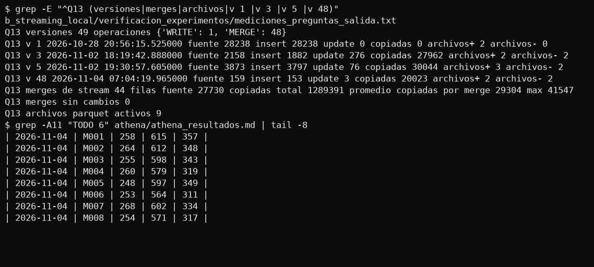

**14. Costos y operación.** Estima el costo mensual de las dos partes con 500K transacciones diarias (S3, Glue, Glue Streaming 24/7, Kinesis y Athena). ¿Qué cambiarías si el streaming no necesitara correr 24/7? ¿Por qué no se debe poner una regla de expiración de S3 sobre `lakehouse/`?

Con precios oficiales de `us-east-1` (API de precios de AWS) y estos supuestos: 500K pagos/día son 15 M al mes, Glue con 2 DPU y 730 horas al mes.

| Servicio | Cálculo | USD/mes |
|---|---|---|
| Glue Streaming 24/7 | 2 DPU × 730 h × 0,44 | **642,40** |
| Kinesis (2 shards) | 2 × 730 h × 0,015 + 15 M PUT × 0,014/M | 22,11 |
| Glue batch | Supuesto: 30 min/día × 2 DPU × 0,44 × 30 días (medido: ~8 min por lote con estos volúmenes) | 13,20 |
| S3 | Supuesto: unos 120 GB acumulados tras un año × 0,023 | 2,76 |
| Athena | Supuesto: 100 GB escaneados × 5 USD/TB | 0,50 |
| **Total** | | **~681** |

El 94 % es Glue Streaming. **Si no necesitara correr 24/7**, cambiaría a `availableNow` por horario, y supondría unos 3 minutos por corrida: cada hora cuesta unos USD 32 al mes y cada 15 minutos unos USD 127, a cambio de esa misma espera en los datos. Kinesis retiene 24 horas, así que no se pierden eventos.

**No se debe poner una regla de expiración sobre `lakehouse/`** porque S3 borraría archivos Parquet que el `_delta_log` todavía referencia, sin que Delta lo sepa, y la tabla dejaría de poder leerse. Para limpiar se usa `VACUUM`, que solo borra lo que ninguna versión vigente necesita.

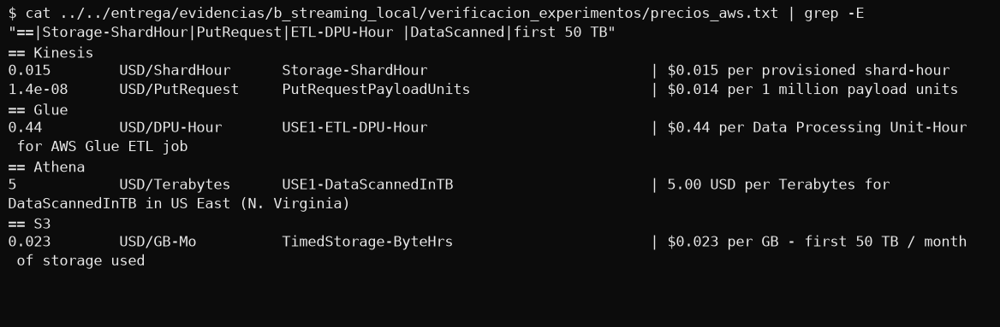

## Ejecución en AWS

Corrida completa del 2026-11-04: deploy, 2 lotes, stream a 20 y a 50 eventos/s, 6 consultas de Athena y limpieza. **Los 10 jobs terminaron en `SUCCEEDED`** y todas las validaciones del stream pasaron. Cambio a un archivo dado: en `jobs/common.py`, Glue 5.0 no entregó la columna `__src_timestamp` que esperaba el código (`KeyError`), sino `$add$record_timestamp$_temporary$`. Se ajustó `read_events` para detectarla; no se tocó ninguna validación.

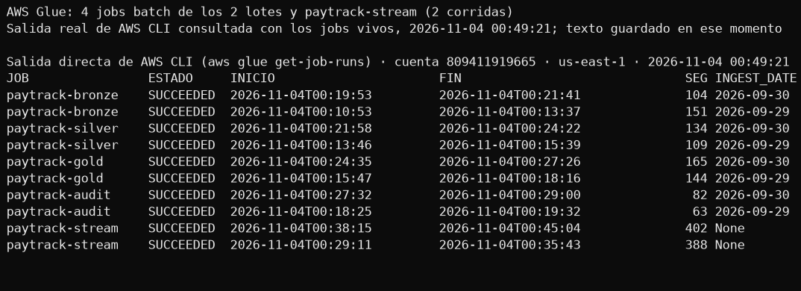

## Experimentos (B.3)

### Experimento 1 · Watermark

**Anota las filas *descartadas por watermark* de `metrics` en modo availableNow (`--fast`) y en vivo.**

| Corrida | Eventos | Descartadas en `metrics` | % |
|---|---|---|---|
| Local · availableNow (`--fast`, 10 min simulados a 20/s) | 12.288 | **6** | 0,05 % |
| Local · en vivo a 20/s | 2.487 | **51** (46 + 5 al apagar) | 2,05 % |
| Local · en vivo a 50/s | 6.195 | **100** (97 + 3 al apagar) | 1,61 % |
| AWS · en vivo a 20/s | 4.965 | **79** | 1,59 % |
| AWS · en vivo a 50/s | 12.307 | **132** | 1,07 % |

**¿Por qué son tan distintas si el productor envía la misma proporción de eventos tardíos?**
Porque el watermark no mide el tiempo real: es el mayor `event_time` visto menos 2 minutos, y solo avanza entre micro-lotes.
Lo que cambia es cuánto tiempo de evento cabe en cada micro-lote.

- **En vivo**, cada micro-lote cubre unos 10 s. El watermark sigue de cerca al tiempo de evento, así que un pago con más de 2 minutos de retraso llega cuando el umbral ya lo superó. A 20/s llegaron 61 eventos con más de 120 s de retraso y Spark descartó 51. La diferencia es consistente con que Spark filtra con el watermark del lote anterior, que va unos segundos atrás.
- **Con `--fast`**, los 10 minutos simulados se procesaron en 4 micro-lotes con datos, de unos 4.000 eventos en los tres primeros. El tardío llega junto a eventos de su misma época, y Spark filtra con el watermark del lote anterior: los dos primeros lotes no descartan nada porque ese valor aún es 0.

Se comprobó recalculando evento por evento con los watermarks guardados en el checkpoint: 0 + 0 + 5 + 1 = **6 filas, igual a lo que reportó Spark**.
Conclusión: `--fast` subestima los descartes, y la cifra representativa de producción es la de la corrida en vivo.

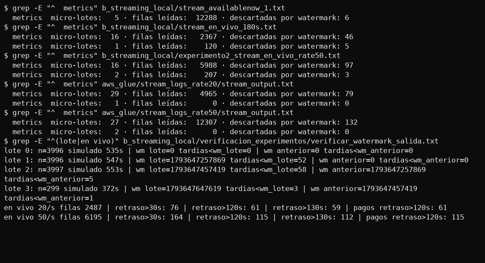

### Experimento 2 · Carga

**Repite la prueba en vivo con `--rate 50`. ¿Qué pasa con el número de alertas?**
Crece mucho más que la carga: con 2,5 veces más eventos hay **8 veces más alertas**. Los aciertos crecen como la carga y las falsas alarmas se disparan.

| Local, solo ventanas de cada corrida | Eventos | Alertas | Aciertos | Falsas alarmas | Precisión |
|---|---|---|---|---|---|
| 20 eventos/s | 2.487 | 47 | 38 | 9 | 80,85 % |
| 50 eventos/s | 6.195 | 375 | 99 | 276 | 26,40 % |

Las ventanas de la corrida a 50/s no se habían cerrado al terminar, porque el productor dura 120 s y el watermark va 2 minutos atrás. Se cerraron enviando 60 eventos nuevos, y se contaron solo las ventanas de cada corrida.

**Mide su precisión en AWS con el TODO 5 de Athena, a 20 y a 50 eventos/s.**

| AWS, TODO 5 | Alertas | Aciertos | Precisión |
|---|---|---|---|
| Tras la corrida a 20 eventos/s | 32 | 30 | **93,75 %** |
| Acumulado tras la corrida a 50 eventos/s | 470 | 140 | 29,79 % |
| Diferencia atribuible a la corrida a 50 eventos/s | 438 | 110 | **25,11 %** |

El 25,11 % es una aproximación: esa diferencia incluye las últimas ventanas de la corrida a 20/s, que se cerraron durante la de 50/s. Las tablas de AWS ya no existen, así que no se puede separar, pero la medición local limpia (26,40 %) da un valor muy parecido.

**Por qué cae la precisión.** La regla (6 o más pagos en 30 s) no cambia, pero la actividad normal sí. Con 500 clientes, un cliente hace en promedio 1,14 pagos cada 30 s a 20/s y 2,85 a 50/s. Si se modela como una distribución de Poisson, la probabilidad de llegar a 6 pagos por azar pasa de 0,12 % a 6,96 %: unas 60 veces más. Las ráfagas de fraude reales solo crecen con la tasa.

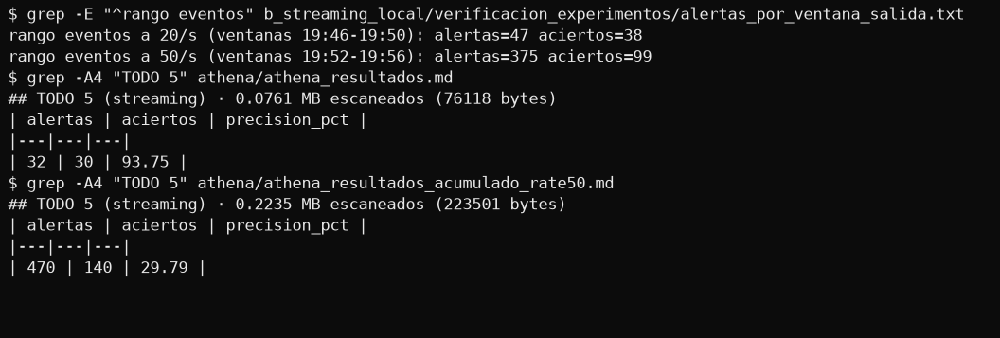

### Experimento 3 · Partition key

**Cambia temporalmente `partition_key` para que devuelva un valor constante, y repite con `transaction_id`. Revisa el reparto con `kafka-get-offsets.sh`.**
Mismo stream en los tres casos (1.227 eventos, `--seed 7`), en topics de 3 particiones. `customer_id` es nuestra llave, incluida como referencia. La llave se restauró al terminar.

| Llave | p0 | p1 | p2 | Partición más cargada frente al reparto ideal (409) |
|---|---|---|---|---|
| Constante | 0 | **1.227** | 0 | +200 % |
| `transaction_id` | 438 | 397 | 392 | +7 % |
| `customer_id` | 491 | 341 | 395 | +20 % |

- **Constante:** todo cae en una sola partición, así que no hay paralelismo y los demás consumidores quedan sin trabajo.
- **`transaction_id`:** es el reparto más parejo, porque casi cada evento tiene una llave distinta.
- **`customer_id`:** reparte peor porque hay solo 500 llaves y las ráfagas concentran varios pagos en una misma llave. Es lo que se paga por mantener en orden todos los eventos de un cliente.

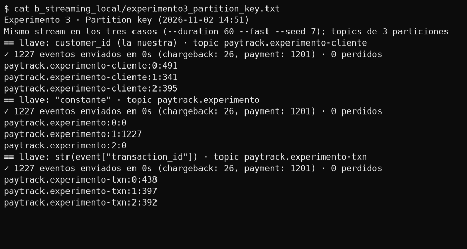

## Diagrama de la arquitectura

Editable en draw.io: `labs/02-lakehouse/entrega/diagrama/arquitectura_lakehouse.drawio`.

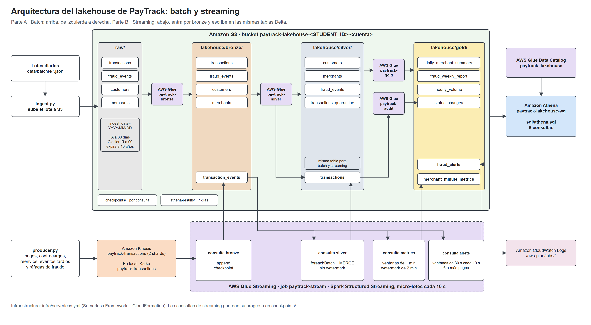

## Evidencias

Salidas completas de la ejecución local, AWS, Athena y la limpieza, en `labs/02-lakehouse/entrega/evidencias/`.
